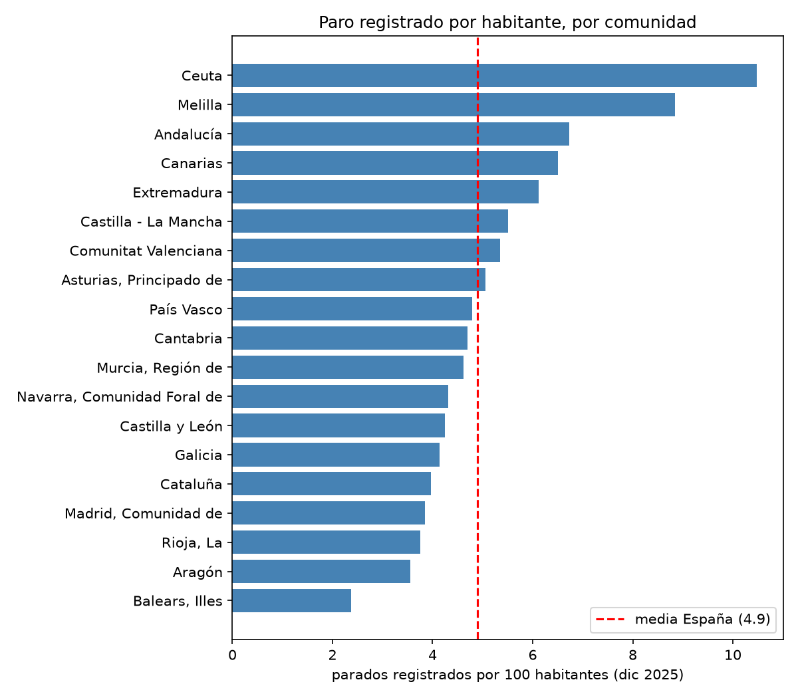

# Del dato crudo a la decisión

Proyecto para clase: coger datos públicos, limpiarlos, consultarlos con SQL, analizarlos con Python, hacer gráficos y sacar una conclusión. El análisis completo está en `entregable.ipynb`.

## Cómo ejecutarlo

```bash
git clone https://github.com/renzorico/del-dato-crudo-a-la-decision.git
cd del-dato-crudo-a-la-decision
python3 -m venv .venv
source .venv/bin/activate
pip install -r requirements.txt
jupyter notebook entregable.ipynb
```

Hace falta Python 3.12. No hay variables de entorno.

## Estructura

| Ruta | Contenido |
|---|---|
| `entregable.ipynb` | Todo el análisis |
| `data/raw/` | Datos originales sin tocar |
| `data/processed/` | Datos ya limpios y unidos |
| `sql/` | Las consultas |
| `img/` | Gráficos |

## Los datos

Son dos ficheros de 2025:

- SEPE, paro registrado por municipio (`Paro_por_municipios_2025_csv.csv`). 12 meses, 8.135 municipios, separado por sexo, edad y sector.
- INE, población por municipio (`ine_29005_poblacion_municipios_2025.csv`). 8.138 municipios, solo 2025.

Se unen por el código de municipio. El resultado está en `data/processed/paro_poblacion_2025.csv`.

## Preguntas

1. Comunidades y municipios con más paro registrado en relación con su población
2. Cómo evoluciona el paro durante 2025
3. Diferencia entre hombres y mujeres
4. Influye el tamaño del municipio

## Limpieza

- Había espacios sueltos en los nombres de columnas.
- El SEPE pone `<5` cuando hay muy pocos parados, así que esas columnas se leían como texto. Lo cambié por 2.
- En el INE el código y el nombre vienen juntos (`44001 Ababuj`), los separé.
- Seis municipios del INE sin población, rellenados con la mediana. No cruzan con el paro.
- No hay duplicados y los 8.135 municipios del SEPE cruzan con el INE.

## SQL

Uso duckdb sobre el dataframe. Hay tres consultas en `sql/`: tasa por comunidad, municipios grandes con más paro y evolución mensual por sexo. La primera la comprobé también con pandas.

## Resultados

En diciembre de 2025 hay 2,41 millones de parados registrados, 4,9 por 100 habitantes, un 7% menos que en enero. Lo más alto está en Ceuta, Melilla, Andalucía y Canarias, y entre los municipios grandes en Cádiz y Sevilla. Las mujeres son el 60% del paro. Las conclusiones y limitaciones están en el notebook.



## Para usarlo en clase

El código carga los dos CSV, los limpia, los une, calcula parados por 100 habitantes, hace las consultas SQL y dibuja los gráficos. Lo que se aprende: los datos reales vienen sucios, hay que decidir qué hacer con los huecos (el `<5`, los NaN) y esa decisión cambia el resultado, y una tasa depende de entre qué divides.

Para un grupo sin experiencia se puede empezar directamente con `data/processed/` y leer los gráficos. Para uno con más nivel, pedirles que calculen la tasa sobre población en edad de trabajar o que traten los `<5` de otra forma y comparen.

Problemas típicos:

- Error al leer el CSV del SEPE: usar `encoding='latin-1'`.
- Se pierde el cero de los códigos (`04001` pasa a `4001`): leer con `dtype={'Codigo Municipio': str}`.
- Los números del INE llevan punto de miles: `thousands='.'`.
- Si el cruce da NaN, mirar que los códigos sean texto en los dos lados.
